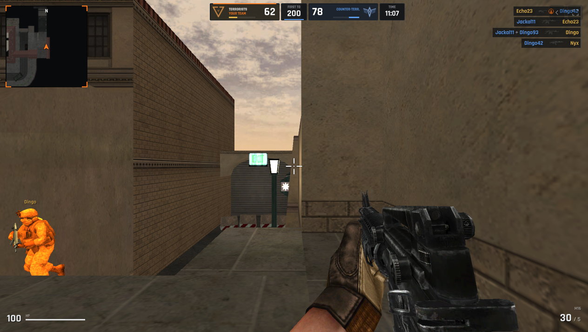

# BLACKLIST — offline mirror

Full mirror of **BLACKLIST** — "Tactical multiplayer FPS" (https://playblacklist.com/),
a Unity 6 WebGL browser FPS (team deathmatch, deathmatch and bomb defusal).

Source: https://playblacklist.com/



## Stack

- **Unity 6 WebGL build (6000.4.4f1, IL2CPP)** — `/api/build` resolves the deployed
  build: loader `game/Build/game.loader.js` (createUnityInstance bootstrap), data
  `game.data.br` (71.3 MB, `UnityWebData1.0` archive with the IL2CPP metadata),
  framework `game.framework.js.br` (377 KB engine framework) and code
  `game.wasm.br` (50.8 MB wasm). The origin serves the `*.br` payloads
  **browser-decoded** (identity; the hcdn edge re-compresses per
  `Accept-Encoding`), so the capture holds the plain streams and a naive static
  server serves them as-is — no `Content-Encoding` juggling (the Unity loader
  accepts data without a compression marker; only still-compressed bodies are
  rejected).
- **StreamingAssets UnityFS asset bundles** — `game/StreamingAssets/Bundles/`:
  `weapons/weapons` is the AssetBundleManifest whose table lists all **134**
  per-weapon bundles + `weapons_common.bundle` (animations, gun audio, textures,
  materials, shaders, meshes), and `maps.json` names the **eight** deployed
  scene bundles (`gs_*.bundle`, 0.9–26.9 MB each) plus the shared
  `maps_common.bundle` (26.7 MB, new 2026-10-29). Both manifest sources were
  parsed to derive the closure, then every listed file fetched.
- **Hand-written site shell** — plain ES5/ES6, no bundler, no framework:
  `js/site.js` (build status + leaderboard tables), `js/launch.js` (launch gate
  against `/api/launch`), `js/nav.js` (account header), `js/play.js` (Unity
  bootstrap), `js/ads.js` (Google H5 rewarded ads — `data-ads-mode="off"`,
  the SDK is only injected in test/live mode), `js/leaderboard.js`,
  `js/account.js`; one shared `css/site.css` + `css/play.css` (Rajdhani from
  Google Fonts, external).
- **hcdn / Hostinger static host** — `/` and the routes are server-rendered
  shells; `/game/**` is hotlink-protected (requests without a browser UA/Referer
  get HTTP 403), captured with browser headers.
- **External, not mirrorable**: the account API `/api/v1/*` (`guest/check`,
  `servers`, `presence`, `web/whoami`, leaderboards — same-origin paths the
  static mirror answers 404, which the client tolerates as "accounts offline,
  guest only"), the realtime multiplayer backend (Photon PUN, WebSocket —
  `PhotonMessageInfo` strings in the metadata; the client reaches the live
  service directly, matches and ping come from it), Unity Services
  (`config.uca.cloud.unity3d.com`, `cdp.cloud.unity3d.com` telemetry), Google
  Fonts, the YouTube trailer embed, the Discord invite, Google ads.

## What this is

BLACKLIST (playblacklist.com) — "Blacklist is a free tactical multiplayer FPS
that runs in your browser. Team deathmatch, deathmatch and bomb defusal, bots
that fill empty rooms, and a full arsenal with skins." The game itself is the
Unity build at `/play` (v2.1.8 at capture time, HUD text "V2.1.8 · UNITY 6
BUILD"); the site around it is a small server-rendered shell (landing page with
the launch countdown and leaderboards, about, leaderboard, account pages).

The capture is the whole runtime closure: **389 files, 357.0 MiB
(374,292,801 bytes)** — 5 pages + the two live-endpoint JSON snapshots
(`api/build`, `api/launch`), 7 site scripts, 2 stylesheets, 222 images, the four
Unity player files and all 146 StreamingAssets files (weapon index +
`weapons_common` + 134 weapon bundles + `maps.json` + 8 map bundles +
`maps_common.bundle`). The weapons closure came from the AssetBundleManifest
inside `weapons/weapons` (parsed once with UnityPy), the maps closure from
`maps.json`; a browser network-log pass while actually playing (boot → guest →
lobby → live bomb-defusal match) confirmed every request the client makes is one
of the captured files, with zero 404s. `GS_Korea` is named in the client's scene
metadata but is not deployed (`gs_korea.bundle` → 404, absent from `maps.json`)
— recorded as a finding, nothing to capture. `/countdown` is a 302 to `/play`
(no document of its own).

Offline behaviour: the mirror boots from its own bytes and the game works
guest-only ("ACCOUNTS OFFLINE · GUEST ONLY" is a first-class client state); the
guest flow, server picker (EUROPE-1/2, USA-1 are client-side entries) and the
lobby all render offline. The live match list and matches themselves come from
the external realtime backend, so playing against other people (or the bots in
a live room) needs that service reachable — the mirror preserves the client,
not the service.

## Layout

- `index.html` — the entry landing page as served (byte-exact, root-served)
- `play/index.html`, `about/index.html`, `leaderboard/index.html`,
  `account/index.html` — the other routes, captured as directory-index files so
  a static server reproduces `/play`, `/about`, `/leaderboard`, `/account`
- `api/build`, `api/launch` — static snapshots of the two same-origin JSON
  endpoints (`api/build` is what resolves the Unity build URLs; both marked
  `dynamic` in the manifest — presence-only for the drift probe)
- `js/` — the seven site scripts as served; `css/` — `site.css` + `play.css`
- `img/` — 222 files: the landing art (`hero-squad.webp`, `community-leader*.jpg`),
  `img/weapons/` (10), `img/maps/` (8), `img/ranks/` (200 rank icons,
  `rank_01.svg` … `rank_200.svg`, generated from a template literal) and
  `img/backdrop.jpg`
- `game/Build/` — `game.loader.js`, `game.data.br`, `game.framework.js.br`,
  `game.wasm.br` (byte-exact; the `.br` names are upstream's, the bytes are the
  browser-decoded streams)
- `game/StreamingAssets/Bundles/` — `maps.json`, `maps_common.bundle`, 8
  `gs_*.bundle`, and `weapons/` with the index bundle, `weapons_common.bundle`
  and 134 `w<slot>_<id>.bundle` files
- `.upstream/manifest.json` — Gen-A sha256 record for all 389 captured files
- `readable/` — prettified derived layer (pinned prettier 3.9.6, module API to
  a fixed point): the 7 site scripts, the Unity loader, the Unity framework
  (17,583 lines) and the 2 stylesheets as `*.pretty.js|css`, plus the two
  inline prelaunch-gate twins and `inline-map.json` (byte ranges + sha256)
- `src/` + `split-spec.json` — 7 statement-aligned slices of the site scripts
  with an exact 2-line provenance header each, and the derivation record
  (13 sections, 373 notRendered payload records)
- `tools/derive.mjs` — rebuild `readable/` + `src/` + `split-spec.json`
- `tools/capture.mjs` — the closure capture (site + build + StreamingAssets,
  scan-to-fixpoint, rank-icon probe, sanity hashes)
- `tools/verify.mjs` — re-hash the capture against the manifest
- `tools/update.mjs` — read-only drift probe against the live origin
- `tools/audit.js` — integrity gate for the derived layers (`AUDIT PASS`)
- `docs/cover.png`, `docs/boot-2026-10-13.png`, `docs/boot-2026-10-27.png`,
  `docs/boot-2026-10-29-refresh.png` — cover + boot evidence (2026-10-13/27 in
  actual gameplay, 2026-10-29 the refreshed capture's sign-in screen)

## Assets

- **game build payloads** — `game/Build/`: `game.data.br` (71.3 MB Unity data
  archive: IL2CPP metadata, shared assets, resources), `game.wasm.br` (50.8 MB
  wasm), `game.framework.js.br` (377 KB framework), `game.loader.js` (27 KB)
- **weapons (bundles)** — 134 per-weapon UnityFS bundles + `weapons_common.bundle`
  (24.9 MB) + the `weapons` index bundle: `game/StreamingAssets/Bundles/weapons/`
  (`w1_*` … `w5_*` — the bundle files carry the weapon models, skins, animations,
  gun audio and HUD/item art; `weapons_common` holds the shared animation clips,
  ogg audio, textures, materials, shaders and meshes)
- **maps (bundles)** — 8 scene bundles, 0.9–26.9 MB each, plus the shared
  `maps_common.bundle` (26.7 MB):
  `game/StreamingAssets/Bundles/gs_{ancient,desnowoot,forge,hangar,orbital,paris,shipment,zook}.bundle`
  (Greywoot ships as `GS_DeSnowoot`; Paris is new 2026-10-29, UrbanWarfare is no
  longer named by `maps.json`)
- **images** — 222 file(s): `img/` (hero-squad.webp, community-leader-1200.jpg,
  community-leader.jpg, backdrop.jpg), `img/weapons/` (10 landing-page gun
  renders), `img/maps/` (8 map thumbnails), `img/ranks/` (200 rank badges)
- **audio** — inside `game/StreamingAssets/Bundles/weapons/weapons_common.bundle`
  (98 AudioClips, ogg; nothing loose on disk)
- **fonts** — exterior only: Rajdhani served by Google Fonts
  (`fonts.googleapis.com`/`fonts.gstatic.com` stay CDN — socker precedent); the
  favicon is `favicon.svg`
- **data** — `game/StreamingAssets/Bundles/maps.json` (map manifest),
  `api/build` + `api/launch` (endpoint snapshots)

## Run

Serve the repo root with any static file server (the capture is a static site;
no build step, no special headers):

```
npx serve .
```

The game boots at `http://localhost:3000/play` (root `index.html` is the
landing page; the Unity build is under `/game/`). The three `*.br` payloads are
stored browser-decoded, so the server needs no `Content-Encoding` handling; a
server that does not know `.wasm.br` falls back to `application/octet-stream`
and the loader still starts (non-streaming wasm compilation).

## Verify

```
node tools/verify.mjs     # re-hash the capture against the manifest
node tools/audit.js       # derived-layer integrity gate
node tools/check-exports.mjs   # the derived layer still exports every public name
node tools/derive.mjs --check          # the derived layer is current? (compares a fresh rebuild; writes NOTHING)
```

Last run: `389 files checked, 0 problems` and `AUDIT PASS` (2026-10-29 refresh).

## Updating from upstream

```
node tools/update.mjs     # read-only drift probe: what changed upstream
```

The probe never rewrites the capture — a mirror is a point-in-time snapshot.
Note it re-downloads the whole closure (~357 MB) to compare sha256; the two
endpoint snapshots (`api/build`, `api/launch`) are `dynamic` and presence-only.
A refresh means re-running `tools/capture.mjs` into a clean tree (copying every
replaced file into `legacy/<date>/` first), re-cutting
`.upstream/manifest.json`, and re-deriving `readable/` + `src/` with
`node tools/derive.mjs` (which re-parses the new AssetBundleManifest with
UnityPy if the weapon set changed — the bundle list is embedded in the tool).
Known noise: none — `node tools/update.mjs` prints
`up to date: 389 captured files identical upstream`.

### 2026-10-29 refresh

The fleet drift probe (2026-10-29) found 166 of 384 captured files changed
upstream — the origin redeployed on 2026-10-28 (`api/build` `builtAt`
`2026-10-28T07:23:33.960Z`). Re-captured with `tools/capture.mjs`, which now
also fetches the shared `maps_common.bundle` named by `maps.json` and carries
the four new weapon bundles parsed from the live AssetBundleManifest.

- Before: 384 files, 344.5 MiB (361,261,039 bytes), manifest 2026-10-12.
- After: 389 files, 357.0 MiB (374,292,801 bytes).
- Changed: 166 of 384 — the four `game/Build` payloads, the weapons index,
  `maps.json`, all 8 old map bundles, all 136 weapon bundles, `js/account.js`,
  `js/leaderboard.js` and all 22 `img/` files. The other pages are byte-identical
  apart from `play/index.html`'s per-request CSP nonce; the two `dynamic`
  endpoint snapshots were re-cut (`api/build` is now
  `builtAt 2026-10-28T07:23:33.960Z`, `downloadBytes 59,026,597`). `css/*`,
  `js/play.js`, `js/site.js`, `js/nav.js`, `js/launch.js`, `js/ads.js` and the
  200 rank icons were unchanged.
- Added (+6): `gs_paris.bundle` (new map), `maps_common.bundle` (new shared
  bundle), `w2_17.bundle`, `w5_23.bundle`, `w5_24.bundle`, `w5_25.bundle`
  (weapons manifest 131 → 135 entries).
- Dropped (-1): `game/StreamingAssets/Bundles/gs_urbanwarfare.bundle` — still
  served (HTTP 200) but no longer named by `maps.json`, so it left the closure.
  `img/maps/urban-warfare.jpg` stays: the unchanged pages still reference it.
  The new `GS_Paris` has no thumbnail (`img/maps/paris.jpg` is 404 upstream), so
  `img/maps/` still holds 8 files.
- `tools/capture.mjs` sanity `EXPECT` hashes re-baselined to the new payloads
  (independently fetched) and `maps_common.bundle` added to them.
- Gates: `verify.mjs` → `389 files checked, 0 problems`; `audit.js` →
  `AUDIT PASS` (13 sections, 373 notRendered); `check-exports.mjs` →
  `no public export name lost`; `derive.mjs --check` → `DERIVE CHECK PASS`.
  Drift probe after the refresh: `389 checked, 0 changed, 0 missing`.
- Preserved: derived layers of the replaced capture and the changed text
  artifacts in `legacy/2026-10-29/` (`readable/`, `src/`, `split-spec.json`,
  `js/account.js`, `js/leaderboard.js`, the old `.upstream/manifest.json`,
  `_mirror-report.json` and the before-probe JSON). The replaced 343 MiB of
  binary capture files stay recoverable from git history rather than being
  duplicated into `legacy/`.
- Boot: see the 2026-10-29 boot test below.

### 2026-10-12 capture / 2026-10-13 readable+src derivation

Captured with `tools/capture.mjs` (browser UA + Referer — hcdn 403s bare
requests). The Unity build was found through `js/play.js` → `/api/build`
(loaderUrl/dataUrl/frameworkUrl/codeUrl/streamingAssetsUrl); StreamingAssets
were enumerated by parsing `maps.json` and the `weapons` AssetBundleManifest
(UnityPy) and cross-checked against the live browser network log while playing
(boot → guest → server picker → lobby → bomb-defusal match): every game-file
request the client made was one of the captured files, all HTTP 200 — the only
off-origin requests were Google Fonts and Unity Services telemetry.

- `readable/` — pinned prettier 3.9.6 (module API, default options, formatted
  to a fixed point — the CLI respects `.gitignore` and can silently echo its
  input; prettier 3.9.6 is not idempotent on every input, `js/leaderboard.js`
  and `js/account.js` settle on the 3rd pass) rendered the seven site scripts,
  the Unity loader (1,292 lines), the Unity framework (17,332 lines) and both
  stylesheets (13 pretties + 2 inline twins). Every pretty is provably not a
  byte copy of its capture source and re-renders byte-exact under the pinned
  version (13/13).
- `src/` — 7 statement-aligned slices (`src/js__<name>-01.js`, exact 2-line
  provenance header, 47–361 lines) across the seven site scripts, recorded in
  `split-spec.json` (13 sections): 7/7 parse standalone
  (`node --input-type=module --check -`) and round-trip byte-exact to their
  readable line ranges. The site scripts are IIFEs — one slice each; identifiers
  are the app's own declared names (the served code is not minified, so no
  rename campaign applies). The compiled game logic inside
  `game.data.br`/`game.wasm.br` is not decompiled — the reversed layer is the
  app shell + the Unity glue, and that is the honest scope.
- Unity build rule — wholeFile sections, never sliced: the Unity loader
  (`createUnityInstance` bootstrap, guarded on `createUnityInstance` +
  `UnityWebData1.0`) and the engine framework (guarded on `unityFramework` +
  `WebAssembly`). Binary payloads (`.data`, `.wasm`, all 139 `*.bundle`) are
  hashed notRendered records, never rendered; so are the 222 images and the two
  endpoint snapshots (368 notRendered total).
- Inline scan: `index.html` and `leaderboard/index.html` carry the 105-byte
  prelaunch gate inline `<script>` — twins
  `readable/index-inline-1.pretty.js` / `readable/leaderboard__index-inline-1.pretty.js`
  + `readable/inline-map.json` (byte ranges + sha256).
- Gates: `node tools/verify.mjs` → `384 files checked, 0 problems`;
  `node tools/audit.js` → `AUDIT PASS` (7/7 round-trips, 13/13 pretties
  re-render byte-exact, 13/13 tiled sources, 2 inline blocks with twins + map,
  11 derivable captures all twinned, capture manifest free of derived layers);
  `node tools/update.mjs` → `up to date: 384 captured files identical
  upstream`; serve probe — mirror root served on loopback 4355, `/`,
  `/js/launch.js`, the Unity loader, `game.data.br`, `game.wasm.br`,
  `game.framework.js.br`, `maps.json`, the weapons index, `weapons_common.bundle`
  and `gs_shipment.bundle` over HTTP 200, listener PID 27260 killed, port closed
  (netstat + connection refused). Boot evidence and cover are real gameplay
  (`docs/boot-2026-10-13.png`, `docs/cover.png`) — the mirrored client boots
  offline to the sign-in screen, guest flow and lobby (guest-only state), then
  joins a live bomb-defusal match: enemy in frame, killfeed, scoreboard, HUD —
  captured through the opencli browser against the served mirror. The mirror
  session's network log: 29 closure files over HTTP 200 and 16 same-origin
  `/api/v1/*` calls (the account backend, not mirrored) answered 404 by the
  static server — the client's documented guest-only/accounts-offline state;
  off-origin, Google Fonts + Unity Services config/telemetry. Rebuild with
  `node tools/derive.mjs`.
- §0.4 fork-over-mirror checked 2026-10-13: the page and every captured file
  carry no project source repo (zero `github.com`/`gitlab.com` references in the
  384-file scan; the only repo URL is the NuGet metadata of the third-party
  `Newtonsoft.Json-for-Unity` package embedded in the Unity data payload), and
  GitHub searches for "blacklist tactical fps" / "playblacklist" find nothing —
  the origin publishes the deployment only, so the mirror stands.

## Boot test (2026-10-27)

- Entry: `http://127.0.0.1:4911/play` served by `tools/serve.mjs` with the network blocked (`MAP * 127.0.0.1`).
- Outcome: **rendered** — the Unity build booted from the mirror's own bytes
  to the BLACKLIST sign-in screen (`V2.1.8 · UNITY 6 BUILD`), and the local
  guest flow reached the CHOOSE A SERVER screen (EUROPE-1, EUROPE-2, USA-1).
- Evidence: body 0 chars (the whole UI is canvas-rendered); canvas 1262x568;
  0 console errors; 6 failed same-origin requests, 28 blocked cross-origin;
  screenshot `docs/boot-2026-10-27.png` (the guest server picker).
- Gaps seen: same-origin `/api/v1/guest/check` (1) and `/api/v1/servers` (5)
  answered 404 — the account backend this mirror records as not mirrored; the
  client tolerates it (guest-only, servers shown `STATUS UNKNOWN`). Blocked
  cross-origin, expected under the offline rule: Google Fonts (2), Unity
  Services config/telemetry (4 + 22). The game runtime closure itself is
  complete — `/play`, `/api/build` and all four `game/Build` payloads served
  200. The JOIN control was not pressed: it hands off to the external realtime
  backend.
- Claim check: confirms the documented offline behaviour for the
  sign-in → guest → server-picker stages; it refutes no existing claim. The
  lobby was not entered (that needs the live realtime service).

## Boot test (2026-10-29 refresh)

- Entry: `http://127.0.0.1:4717/play` served by `tools/serve.mjs`, headless
  Chrome in an isolated `boot-playblacklist-refresh` session launched with
  `--host-resolver-rules=MAP * 127.0.0.1` (all hosts resolve to loopback).
- Outcome: **rendered** — the refreshed Unity build booted from the mirror's
  own bytes to the BLACKLIST sign-in screen (SIGN IN / CREATE ACCOUNT / GUEST
  tabs, `V2.1.8 · UNITY 6 BUILD`, ACCOUNT SERVER offline indicator).
- Evidence: body 0 chars (the whole UI is canvas-rendered); canvas 1262x568;
  console 899 messages, 0 errors, 4 benign warnings (Unity persistentDataPath
  sync, compressed-audio `getFrequency`); the local server answered 13 requests,
  all HTTP 200 — `/play`, `/css/*`, `/js/ads.js`, `/js/play.js`,
  `/img/backdrop.jpg`, `/favicon.svg`, `/api/build` and all four
  `game/Build` payloads. No off-origin request reached the network;
  screenshot `docs/boot-2026-10-29-refresh.png`.
- Scope: the guest flow was not re-exercised here (the 2026-10-27 record covers
  sign-in → guest → server picker); this run asserts the refreshed build
  renders. The listener (PID 41192) was killed, port 4717 confirmed closed
  (`netstat` empty, curl connection refused), and the browser session closed.

## Mirror conventions

- **Capture layer** — the captured files are byte-exact copies of what the
  origin served; nothing in them is edited. The `game/Build/*.br` payloads hold
  the browser-decoded streams exactly as the client consumes them; vendor code
  (Unity loader, framework, wasm, asset bundles) stays byte-exact and is never
  re-minified or re-hosted.
- **Readable layer** — `readable/` is derived (prettified) and never shipped to
  a browser; it exists so the served code can be read.
- **Provenance** — `.upstream/manifest.json` records sha256 for each captured
  artifact, and `tools/verify.mjs` re-checks it.
- **Drift** — `tools/update.mjs` is read-only: it reports what changed upstream
  and never rewrites the capture.
- **Local records** — `_mirror-report.json` (capture record: requests, paths,
  404s, external refs), `split-spec.json` and `tools/` are local-only and never
  probed.

## Fleet status

<!-- mirror-status:start — feeds _standard/REPO-INDEX.md. Update ONLY your own mirror's block; never edit the shared index (PLAN §8). Rebuild: node _standard/build-index.mjs -->
<!-- cols: cls=classification · ver=verify 0 problems · upd=drift probe · man=manifest · rdbl=readable re-derived · src=reversed src · boot=boot test · top=offline-mirror topic · tag=backup tag · staged=staged not committed -->
| # | repo | cls | ver | upd | man | rdbl | src | boot | top | tag | staged |
|---|---|---|---|---|---|---|---|---|---|---|---|
| 294 | playblacklist | mirror | ✓ | ✓ | ✓ | ✓ | ✓ | ✓ | ✓ | — | — |
<!-- mirror-status:end -->
